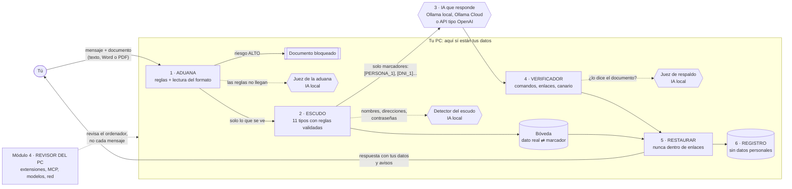
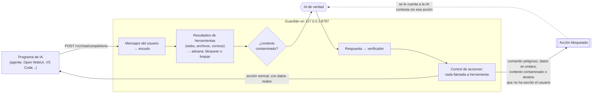

# Arquitectura del Guardián IA

## La idea en una frase

El Guardián se pone **entre la persona y la IA** y aplica cuatro controles: que la IA no reciba tus datos, que un documento no la manipule, que su respuesta no te haga daño y que la IA instalada en tu PC no sea una puerta de entrada. Todo lo que ve datos sin tapar funciona **en tu ordenador**.

## Flujo de un mensaje y dónde interviene la IA

Los hexágonos son piezas con IA. Las líneas punteadas son ayudas opcionales (se activan con `--ia`): si fallan, el Guardián sigue funcionando solo con reglas.



Paso a paso (`guardian/nucleo.py`):

1. **Aduana** (`guardian/aduana/`). Si hay documento, se lee con `lectores.py`. En Word y PDF se separa lo que se ve de lo que no (letra blanca, diminuta, oculta, fuera de la página). Las reglas buscan órdenes para la IA y trucos para esconderlas. Si el riesgo es ALTO, el documento se bloquea y la IA ni se entera. Si es dudoso, el **juez IA local** da una segunda opinión.
2. **Escudo** (`guardian/escudo/`). Las reglas encuentran DNI, NIE, IBAN, tarjetas, teléfonos, correos, IP, matrículas, claves de API y contraseñas, y validan cada dato (letra del DNI, Luhn, control del IBAN). El **detector IA local** busca lo que no tiene forma fija: nombres, direcciones y contraseñas escritas a mano. Cada dato se cambia por un marcador y se guarda en la bóveda, que solo vive en memoria.
3. **IA que responde**. Recibe el mensaje con marcadores, las instrucciones del sistema (con un **código canario**) y el documento ya desinfectado. Puede ser local o remota, y en los dos casos solo ve marcadores.
4. **Verificador** (`guardian/verificador/`). Revisa la respuesta: comandos peligrosos, datos metidos en enlaces o imágenes, webs que imitan a marcas, enlaces acortados, peticiones de contraseñas, datos que la IA no recibió y si ha escrito el canario. Si hay documento, el **juez de respaldo local** comprueba qué frases salen de él.
5. **Restaurar**. Los marcadores vuelven a ser tus datos, salvo los que estén dentro de un enlace o imagen. Las imágenes externas se bloquean.
6. **Registro** (`guardian/registro.py`). Se apunta qué se hizo (cuántos datos, nivel de riesgo, avisos) sin escribir nunca un dato.

El **módulo 4** (`guardian/revisor/`) no está en el flujo de cada mensaje: revisa el PC bajo demanda (`python -m guardian revisar`).

## Modo proxy: el mismo flujo para cualquier programa



Muchos programas hablan con la IA en el formato de OpenAI. Con `python -m guardian proxy`, basta cambiarles la dirección de la IA por `http://127.0.0.1:8787/v1`. El proxy hace lo mismo que el chat y además vigila los **agentes**:

- Los resultados de herramientas (role `tool`) pasan por la aduana, porque es por donde entra la prompt injection indirecta. Si son peligrosos, se cambian por un aviso.
- Si en la petición hay algo sospechoso, el contexto queda **contaminado** y la IA no puede usar herramientas en esa respuesta. Es la idea del patrón "dual LLM" y de CaMeL: lo que viene de fuera no puede disparar acciones. El juez IA solo mira lo que viene de fuera (resultados de herramientas); tus mensajes se revisan solo con reglas, porque pedirle cosas a la IA es justo lo que deben hacer y el juez los tomaría por ataques.
- Con `--marcar-datos`, los resultados de herramientas llegan a la IA **señalados** ("spotlighting", Hines et al., 2024): con un aviso de que son datos y no órdenes, y entre etiquetas con un código al azar que el atacante no puede cerrar (`delimitar`) o con una marca `ˆ` entre cada palabra (`marcas`, que se quita de la respuesta si la IA la copia). Es una ayuda para el modelo, no una barrera: su efecto se mide en `evaluacion.md`.
- Cada llamada a herramienta se revisa con el verificador: comandos peligrosos y datos metidos en enlaces se bloquean siempre.
- **Leer sin actuar** (`--leer-sospechosos`): por defecto, un resultado de herramienta con riesgo ALTO se cambia entero por un aviso, así que la IA tampoco puede contestar con lo que había de útil. Con esta opción la IA lo lee desinfectado y el contexto queda contaminado: puede contestar, pero no hacer acciones. Solo se permite si las acciones tras leer algo sospechoso siguen bloqueadas. En los dos casos, la respuesta final lleva una nota del Guardián: que ha tapado ese resultado o que la IA ha contestado después de leer algo con posibles órdenes ocultas.
- **Confirmación humana** (`--confirmar`): las acciones dudosas para el control de destinos no se bloquean directamente, sino que el proxy te las enseña en su ventana con los datos reales y espera un sí (`--confirmar enviar_correo` pregunta además siempre por esa herramienta). Lo peligroso (comandos, datos en enlaces, herramientas prohibidas, contexto contaminado) se bloquea sin preguntar.
- **Seguir tras un bloqueo**: si se bloquean todas las acciones de una respuesta, el proxy se lo cuenta a la IA (como si fuera el resultado de la herramienta: "esta acción NO se ha hecho porque...") y le pide que conteste sin ellas, sin volver a ofrecerle esas herramientas. Así el ataque no funciona y el usuario recibe lo que pidió. Solo hay una segunda oportunidad, y pasa por los mismos controles.
- **Control del flujo de datos**: una acción no puede mandar nada a una dirección de correo que la IA ha sacado de lo que ha leído (una web, un archivo), y tus datos solo pueden ir a destinos (correos o webs) que aparecen en tus mensajes. Esta capa no depende de detectar el ataque: funciona aunque la trampa no use ninguna frase conocida. Se añadió después de ver en el experimento del agente que, con solo reglas, una trampa nueva pasaba la aduana (ver `evaluacion.md`).

## Qué ve cada pieza con IA

| Pieza | Modelo | Dónde | Qué recibe | Qué devuelve | Si falla |
| --- | --- | --- | --- | --- | --- |
| Detector del escudo | Qwen3.5 (2B o 9B) | Siempre local (se niega a usar una IA remota) | Tu texto **sin tapar**, en trozos de 3000 caracteres | JSON con tres listas: personas, direcciones, contraseñas | Aviso y solo reglas |
| Juez de la aduana | Qwen3.5 | Siempre local | El documento **sin tapar** (máx. 6000 caracteres) entre marcas con un código aleatorio | JSON `{es_ataque, motivo}` | Aviso y solo reglas |
| Juez de respaldo | Qwen3.5 | Siempre local | La respuesta y el documento, ya tapados | JSON con números de frase respaldadas, contradichas y sin respaldo | Aviso, sin respaldo |
| IA que responde | La que elijas | Local o nube | Solo texto con marcadores, instrucciones del sistema con canario y documento desinfectado | Texto | Error visible |

Las tres primeras piezas usan **salida estructurada** (el modelo está obligado a contestar con un esquema JSON) y se filtra lo que devuelven: por ejemplo, el detector solo acepta datos que aparecen literalmente en el texto, así una alucinación no tapa nada que no exista.

## Estructura del código

```
guardian/
  __main__.py      programa de terminal: estado, chat, proteger, aduana, verificar, revisar, proxy, evaluar
  config.py        ajustes por variables de entorno
  ia.py            clientes de IA (Ollama, Ollama Cloud, API OpenAI) y regla "lo sensible, solo local"
  nucleo.py        el flujo de la figura de arriba
  proxy.py         modo proxy compatible con OpenAI y control de acciones
  registro.py      auditoría en JSONL sin datos
  evaluacion.py    medición con los conjuntos propios
  escudo/          validadores.py, detectores.py (reglas), detector_ia.py, escudo.py (tapar y restaurar)
  aduana/          aduana.py (reglas), lectores.py (Word y PDF), juez_ia.py, muestras.py (documentos de prueba)
  verificador/     salida.py (comandos, exfiltración), enlaces.py, respaldo.py, verificador.py
  revisor/         extensiones.py, conectores.py, modelos.py, red.py, revisor.py, demo.py, lista_negra.json
app_web.py         web con Streamlit (solo escucha en tu PC)
evaluacion/        conjuntos, generadores, experimento de prompts, conjuntos públicos y resultados
ejemplos/          documentos con trampa y limpios, y el agente de demostración
tests/             pruebas automáticas con una IA falsa (no necesitan Ollama)
docs/              esta documentación
```

## Tecnologías

| Parte | Tecnología | Por qué |
| --- | --- | --- |
| Lenguaje | Python 3.11 o superior | Es el lenguaje de la IA y de la ciberseguridad; librerías para todo |
| IA local | Ollama + Qwen3.5 (9B en el PC, 2B para pruebas) | Gratis, sin enviar datos fuera, buen español y salida estructurada |
| Conexión con la IA | librería `ollama` y `httpx` (API compatible con OpenAI) | Cambiar de proveedor sin tocar el resto |
| PDF | `pdfminer.six` | Da el color, el tamaño y la posición de cada letra: hace falta para ver el texto escondido |
| Word | Solo la biblioteca estándar (`zipfile`, `xml`) | Un .docx es un zip con XML; menos dependencias, menos riesgos |
| Web | Streamlit | Interfaz en el navegador con poco código |
| Calidad | pytest (146 pruebas), ruff, GitHub Actions en Windows y Linux | Cada cambio se comprueba solo |

## Hardware

| Equipo | Para qué | Datos |
| --- | --- | --- |
| Portátil de desarrollo (el mío) | Uso real y pruebas con el modelo grande | Windows, 32 GB de RAM, NVIDIA RTX 4070 Laptop con 8 GB de VRAM. Ollama con `qwen3.5:9b` y contexto de 8192; `qwen3.5:4b` si va lento |
| Entorno de pruebas sin GPU | Medir con los dos modelos sin depender del portátil | Linux, solo CPU. Qwen3.5 2B: unos 5 s por texto; 9B: unos 18 s por texto |
| Mínimo para usarlo | Escudo, aduana, verificador y revisor sin IA | Cualquier PC con Python: las reglas tardan menos de 1 ms por texto |
